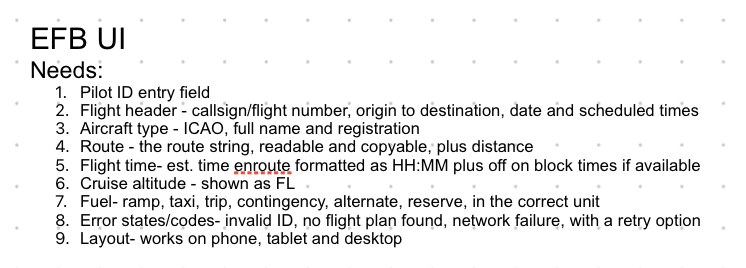
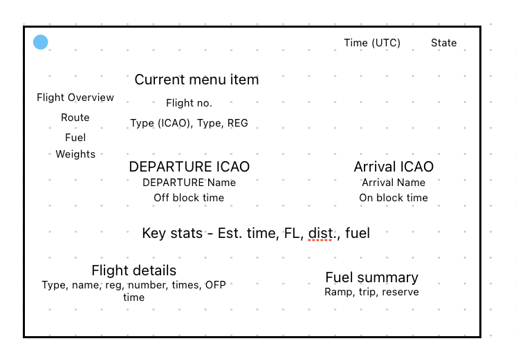
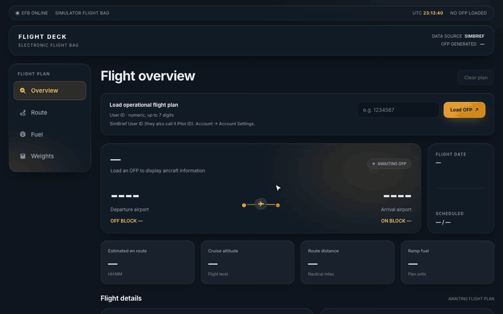
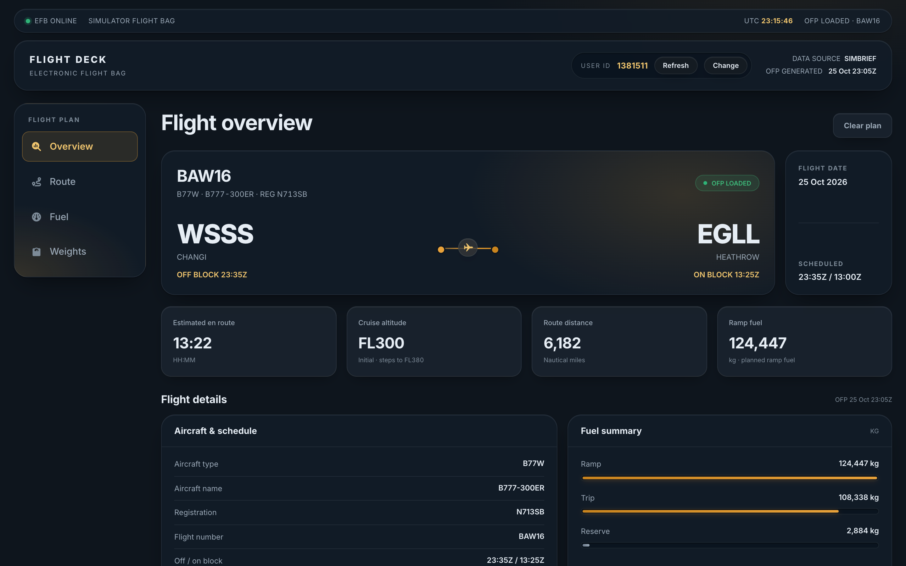
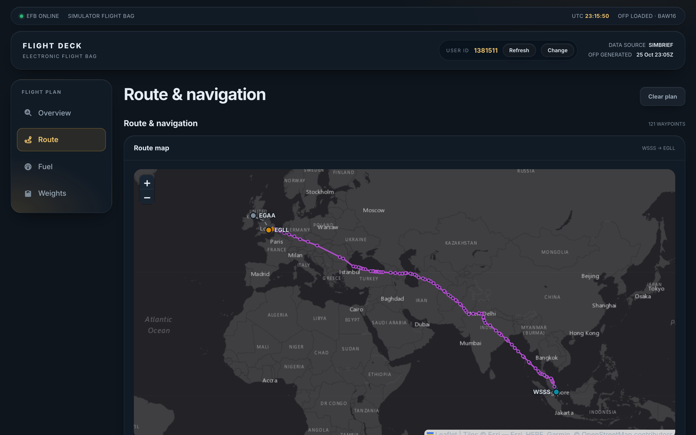
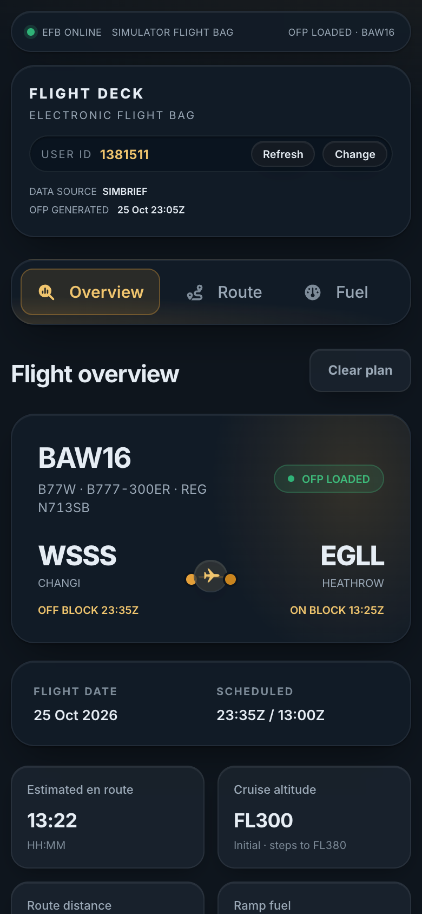

# Flight Deck EFB

A small Electronic Flight Bag that loads a pilot's latest SimBrief flight plan (OFP) and shows it the way a pilot would want to read it: flight header, route map, fuel, weights and times.

## How to run

You need Node.js installed. Then:

```bash
cd simbrief-efb
npm install
npm run dev
```

Vite will print a local URL (usually `http://localhost:5173`). Open that, type your SimBrief User ID, and hit Load OFP.

SimBrief calls it a Pilot ID in the account page - same number. Account -> Account Settings.

Other commands I used a lot:

```bash
npm test          # vitest
npm run build     # production build
```

## Breakdown/Thought Process

1. I first started by analysing different current existing EFBs

2. I then broke down the components of an EFB and made a list of all the needs of my EFB

   

3. I then created a plan in a document for me to follow and tick-off along the way after decomposing the full problem and removing abstraction. I also made a list of what data is provided using the simbrief API

   - Stack - React, TypeScript and Vite for portability and universality
   - No proxy - app calls requests directly
   - Design - Custom designed
   - Features needed - (above)
   - Deadlines for each subtask

4. Designing the UI - I designed the UI on a simple editor to allow me to easily position the sections as I wanted. I ensured I am using all relevant data from my research stages of what I can get from the simbrief API

   

5. Development - Following all my plans and research, I built each subprogram and tested along the way using iterative testing, before building a full program. I refined this many times with the use of AI to enhance it and make it clearer.

6. Testing - Using AI, we put together hundreds of tests to validate and ensure the program works as expected

7. Comparisons to the initial spec and plan, and filling in any gaps

8. Cleaning up - I refined the code and used AI to clean it up and enhance my comments. AI usage is documented at the bottom of this README

---



| Overview | Route map | Phone |
| --- | --- | --- |
|  |  |  |

## Features

- **User ID input** with validation (numbers only, up to 7 digits) and a hint on where to find it. Once a plan loads, the form collapses into a User ID chip in the header with **Refresh** and **Change**.
- **Overview:** callsign, aircraft and registration, origin and destination (ICAO code and airport name) with off/on block times, flight date, scheduled times, time en route (HH:MM), cruise level (initial level and highest step climb), distance and ramp fuel.
- **Route:** every waypoint from the OFP plotted on a map, with the SID, en-route section, STAR and alternate drawn in different colours. Hover a waypoint for its airway and planned altitude. The filed route string can be copied in one click.
- **Fuel:** ramp, taxi, trip, contingency, alternate and reserve, each with its share of ramp fuel, in the plan's own units (kg or lbs).
- **Weights:** ZFW, TOW and LDW against their limits, plus passengers, cargo and payload.
- **Loading state:** an animated loader with skeleton cards and disabled buttons while fetching.
- **Error and empty states** for every case (see [Error handling](#error-handling)).
- **Remembers the last User ID**, so returning pilots see their latest flight straight away.
- **Status bar** with a live UTC clock, connection status and the OFP's generation time.
- **Responsive:** sidebar tabs on desktop, a horizontal tab bar and stacked cards on phones.

## Project structure

```text
src/
├── api/              SimBrief request, error types
│   └── __fixtures__/ Real (trimmed) SimBrief responses used by the tests
├── types/            simbrief.raw.ts (API shape) and ofp.ts (app model)
├── lib/              Pure logic: mapping, formatting, validation, geometry, storage
├── hooks/            useOfp (request state), useUtcClock, useOnlineStatus
├── components/
│   ├── layout/       Status bar, header, User ID chip, sidebar tabs
│   ├── form/         User ID form
│   ├── panels/       One component per tab: Overview, Route, Fuel, Weights
│   ├── ofp/          Flight header, stats, route map, fuel bars, copy button
│   ├── states/       Loader, error banner, error boundary
│   └── ui/           Card, DataList
├── styles/efb.css
└── App.tsx
```

## Design decisions

**No proxy.** The SimBrief fetcher (`xml.fetcher.php?json=1`) sends `Access-Control-Allow-Origin: *`, checked against the live API, so the browser calls it directly. A proxy would only be worth adding to hide an API key, cache responses or rate-limit, and none of those apply here.

**A mapping layer between SimBrief and the UI.** SimBrief's JSON is converted from XML, which gives it some quirks:

- every value is a string, numbers included (`"initial_altitude": "36000"`)
- empty fields arrive as `{}`, not `""` or `null` (for example `icao_airline` on a GA flight)
- repeated nodes are an array, but a single object when there is only one (waypoints, alternates)
- the `is_sid_star` flag is not set on a procedure's last fix, so SID and STAR legs are identified by the procedure name instead

[`lib/mapOfp.ts`](src/lib/mapOfp.ts) and [`lib/mapRoute.ts`](src/lib/mapRoute.ts) are the only places that know about these. They turn the raw response ([`types/simbrief.raw.ts`](src/types/simbrief.raw.ts)) into a clean, typed `Ofp` ([`types/ofp.ts`](src/types/ofp.ts)) with real numbers, `Date`s and `null` for missing values. Components only ever import the clean model, so if SimBrief changes a field, the fix is in one file.

**Request state as a discriminated union.** [`useOfp`](src/hooks/useOfp.ts) holds exactly one of `idle`, `loading`, `success` or `error`, so a component can't read flight data unless the load succeeded.

**Double submits and stale responses.** Every new request aborts the previous one with an `AbortController`, and results from an aborted request are ignored. A slow earlier response can never overwrite a newer one. Requests also time out after 15 seconds, and the timeout is reported separately from a user cancelling.

**No data-fetching library.** There is one endpoint and one piece of state, so a small hook is enough and keeps the request lifecycle visible. React Query or SWR would be worth it with more endpoints or caching needs.

**Heavy parts load on demand.** Leaflet only downloads when the Route tab is first opened, and the Lottie animation only when a load starts. The loading panel and its text appear immediately, with the animation following a moment later. This keeps the main bundle to about 80 KB gzipped.

**Map.** The navlog starts at the first SID fix, so the origin airport is added at the front. Consecutive legs of the same segment are drawn as one line, and longitudes are adjusted where a route crosses the 180° meridian, so a Pacific crossing doesn't get drawn the long way round the map. The map uses whole zoom levels, because fractional zoom leaves seams between tiles.

**Cruise altitude.** Long-haul flights often start low and step up (FL230 to FL390 on an A380 to Mumbai), so the initial level is shown together with the highest step climb rather than the initial level alone.

**Accessibility.** The form uses real labels and inline errors (`aria-invalid`), errors are announced as alerts and status changes politely, the sidebar follows the ARIA tabs pattern with arrow key, Home and End support, and focus rings are visible. Every text colour passes 4.5:1 contrast on the surface it sits on. Reduced motion and reduced transparency preferences are respected.

## Error handling

| Situation | What the user sees |
| --- | --- |
| Empty or non-numeric ID | Inline message under the field; no request is sent |
| Unknown ID or no OFP yet (HTTP 400) | "No flight plan found", with the form left open to fix the ID and **Retry** for after generating a flight in SimBrief |
| No connection | "Can't reach SimBrief" with **Retry** |
| SimBrief takes longer than 15 s | "SimBrief is taking too long" with **Retry** |
| Server error or unreadable response | "Something went wrong" with **Retry** |
| Unexpected crash in the UI | An error boundary shows a fallback panel with **Reload** instead of a blank page |

## Testing

99 tests with Vitest and Testing Library:

- **Logic:** formatters, the SimBrief mapper (run against two real flight plans, one with empty fields), route segmentation, map geometry including date-line crossings, fuel breakdown and validation.
- **API layer:** success, 400, network failure, 5xx, unreadable responses, timeout and cancellation, with `fetch` mocked.
- **`useOfp` hook:** state changes, remembering the ID, retry, clear, and a slow earlier response not overwriting a newer one.
- **Whole page** ([`App.test.tsx`](src/App.test.tsx)): loading a flight, the loading state, auto-loading a remembered ID, validation, the unknown-ID and offline paths including Retry, the User ID chip with Change and Cancel, switching tabs by mouse and keyboard, and Clear plan.

## Credits

- Flight plan data from the [SimBrief API](https://developers.navigraph.com/docs/simbrief/fetching-ofp-data) by Navigraph.
- Loading animation: ["Flight loader"](https://lottiefiles.com/free-animation/flight-loader-lottie-json-animation-kEpRO1MBju) by Weblodge on LottieFiles ([Lottie Simple License](https://lottiefiles.com/page/license)).
- Tab icons: [Font Awesome Free](https://fontawesome.com) ([CC BY 4.0](https://fontawesome.com/license/free)).
- Map tiles: Esri World Light Gray Canvas. Map data © OpenStreetMap contributors.
- Font: [Inter](https://rsms.me/inter/) via Google Fonts (SIL Open Font License).

## Use of AI (Artificial Intelligence)

- AI was used to enhance this project through cleaning up code before final submission to ensure it is efficient and makes sense. For example, parts of this README were reworded and strengthened using AI, which added some bits that I missed.
- Most of the code files have been totally cleaned up by AI and comments refined with AI, however my thought processes is clearly documented above.
- Plans, decomposition, abstraction, and ideas were solely created, and ideas developed by myself.
- All moodboards and brainstorms were solely created by myself.
